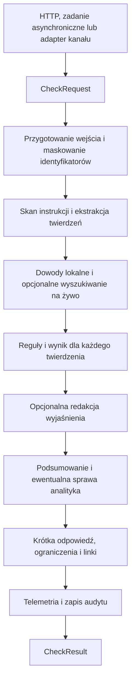

# Przebieg sprawdzenia

Główna funkcja [`service.run_check()`](../../backend/prawdowid/service.py) obsługuje wszystkie pełne sprawdzenia niezależnie od kanału. Przyjmuje `CheckRequest`, opcjonalnie raportuje postęp i zwraca `CheckResult`. Zapisuje też przebieg w SQLite. Poniższa kolejność jest istotna dla prywatności, odporności na manipulację i spójności odpowiedzi.

## Droga od wiadomości do wyniku

## Stan jednego sprawdzenia

`_CheckContext` przechowuje żądanie, budowany wynik, czasy etapów, funkcję postępu, tryb działania i informacje o niedostępnych dostawcach. Powstaje osobno dla każdego sprawdzenia. `_PreparedInput` przenosi przygotowany tekst, oryginalną wiadomość po maskowaniu, odczyt OCR, treść strony z wiadomości oraz adres wejściowy.

Etapy modyfikują wspólny wynik, ale nie współdzielą kontekstu między użytkownikami. Globalny indeks i modele są osobnymi zasobami procesu.

## 1. Przygotowanie wejścia

`_prepare_input()` normalizuje wiadomość i ogranicza jej długość zgodnie z konfiguracją. Opcjonalny obraz przechodzi przez [`ocr.py`](../../backend/prawdowid/ocr.py), a odczytany tekst dołącza do pytania. Następnie maskowane są bezpośrednie identyfikatory, zanim tekst zostanie wykorzystany w wyszukiwaniu i zapisie.

Są dwie różne ścieżki adresów:

- Sam URL lub pole `url`: pobrana strona jest główną treścią do sprawdzenia. Nieudane pobranie daje osobny status techniczny lub informację o niedozwolonym adresie.
- Wiadomość zawierająca pytanie i link: pytanie pozostaje treścią główną, a strona dostarcza kontekstu. Awaria pobrania jest ostrzeżeniem; nadal można sprawdzić samą wiadomość. Gdy pytanie nie zawiera konkretnej tezy, twierdzenia mogą zostać wyciągnięte ze strony.

[`fetch.py`](../../backend/prawdowid/fetch.py) sprawdza adres i każde przekierowanie pod kątem SSRF, ogranicza rozmiar i czas oraz wyodrębnia treść. Pobrane treści są niezaufanymi danymi. Nazwiska i liczby istotne dla faktów nie są automatycznie usuwane; URL pozostaje adresem możliwym do pobrania.

## 2. Weryfikacja wejścia

`_verify_input()` dodaje ostrzeżenia o statusie źródła i skanuje wiadomość oraz OCR. Metadane, takie jak autor i liczniki udostępnień, są usuwane przed neutralizacją instrukcji, ponieważ neutralizacja łączy linie.

Następnie [`claims.py`](../../backend/prawdowid/claims.py) wybiera do trzech twierdzeń. Prośba o wykonanie zadania, niejasne wejście lub brak rozpoznawalnej treści otrzymuje osobny status. Pytanie o tożsamość podlinkowanego materiału może trafić do [`provenance.py`](../../backend/prawdowid/provenance.py).

Dla zwykłych twierdzeń `LiveStage` może rozpocząć Google Fact Check równolegle z lokalnym silnikiem. Po lokalnej weryfikacji dołącza znalezione materiały i, jeśli trzeba, wykonuje ograniczone wyszukiwanie zaufanych stron. Dowody z internetu przechodzą przez te same reguły co korpus. Szczegóły opisuje [przewodnik źródeł](SOURCES.md).

## 3. Wyjaśnienie i podsumowanie

`_apply_optional_llm()` może uprościć gotowe wyjaśnienia, gdy skonfigurowano model. Nie zmienia przypisanej klasy werdyktu. Przy awarii lub odrzuceniu tekstu zachowywany jest wariant deterministyczny, a wynik ujawnia ograniczenie.

`_summarize_claims()` tworzy opis liczby i rodzajów twierdzeń, edukacyjne sygnały SPRAWDŹ oraz wspólne podsumowanie. Sygnały edukacyjne nie wpływają na ocenę.

## 4. Sprawa i odpowiedź

`_create_analyst_case()` kieruje nierozstrzygnięte, sprawdzalne zgłoszenie lub przypadek wskazany regułą wysokiego ryzyka do kolejki analityka. Podobieństwo embeddingów służy do grupowania powtórzeń. Komunikat z ID sprawy powstaje dopiero po udanym zapisie.

`_finalize_answer()` uruchamia [`answer.finalize()`](../../backend/prawdowid/answer.py) i dobór przydatnych stron. Błąd warstwy prezentacyjnej jest logowany; nie ma zmieniać ustaleń silnika. Zewnętrzne alerty Discorda są wysyłane przez osobny proces bota, nie przez tę funkcję.

## 5. Telemetria i zapis

`_save_result()` kończy pomiar, zapisuje czasy i estymatę kosztu oraz wywołuje warstwę SQLite. Awaria zapisu audytu jest logowana. Format baz i usuwanie danych opisuje [model danych](../DATA_MODEL.md).

## Ręczne i bierne sprawdzenie

Dla `mode="auto"` obowiązują dodatkowe ograniczenia: lokalny korpus, brak pobierania URL, brak live-search i LLM, brak spraw moderatora oraz audyt bez treści wejścia. Zapisywany jest skrót SHA-256 i ograniczony opis dowodów. To ścieżka biernego sprawdzania wtyczki, nie to samo co jawnie wywołane sprawdzenie fragmentu.

Szybki router `quick_score()` jest oddzielną funkcją w `service.py`. Zwraca `none`, `candidate` lub `match`. `candidate` jest wskazówką do ewentualnego dalszego sprawdzenia, a nie oceną pokazywaną użytkownikowi. Router ma cache i ograniczenie współbieżności.

## Kontrakty, których nie należy przypadkowo zmieniać

- Błąd techniczny nie staje się werdyktem o treści.
- Instrukcje ze źródła nie zmieniają zasad sprawdzania.
- Maskowanie identyfikatorów poprzedza analizę i wysyłanie zapytań.
- Werdykty, źródła i krótkie odpowiedzi są wspólne dla kanałów.
- Dodanie sprawy do kolejki nie oznacza rozpatrzenia jej przez analityka ani doręczenia powiadomienia.
- Czas `total_ms` jest czasem ściennym przebiegu; estymata kosztu nie jest pomiarem zużycia CPU ani rachunkiem od dostawcy.
