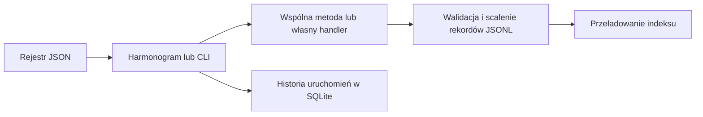

# Źródła i wyszukiwanie

Backend ma dwa odrębne sposoby zdobywania materiałów: okresowe pobieranie do korpusu oraz wyszukiwanie na żywo podczas sprawdzenia. Oba korzystają z rejestru, ale mają inne cykle życia, limity i zasady zapisu.

## Rejestr jako konfiguracja

[`sources/registry.py`](../../backend/prawdowid/sources/registry.py) czyta `data/sources/<id>.json`, waliduje pola i udostępnia kwalifikację źródła. Pełny kontrakt pól, metod, licencji i zakresu organizatora znajduje się w [SOURCE_REGISTRY.md](../SOURCE_REGISTRY.md).

`enabled` steruje pobieraniem i kwalifikacją pliku korpusu do indeksu. Obecna implementacja ładuje także pliki korpusu bez wpisu w rejestrze. Nie należy zakładać, że brak konfiguracji automatycznie oznacza wykluczenie dokumentów.

Panel [`admin_api.py`](../../backend/prawdowid/admin_api.py) zapisuje konfigurację i dziennik zmian. Publiczny katalog jest projekcją danych dla czytelnika, a nie osobnym rejestrem. [`catalog.py`](../../backend/prawdowid/catalog.py) podsumowuje wydawców dokumentów obecnych w indeksie; nie decyduje, którym źródłom wolno rozstrzygać.

## Pobieranie okresowe



[`sources/scheduler.py`](../../backend/prawdowid/sources/scheduler.py) wybiera źródła wymagające odświeżenia i serializuje ich pobieranie. Blokada procesu i plik blokady chronią przed jednoczesnymi uruchomieniami. Po zmianie kwalifikowanych plików indeks może zostać przeładowany bez restartu API.

[`sources/state.py`](../../backend/prawdowid/sources/state.py) zapisuje uruchomienia i zmiany administratora w SQLite. Konfiguracja źródła pozostaje JSON-em, a wynik operacyjny, np. awaria czy liczba nowych dokumentów, trafia do historii uruchomień.

[`sources/fetchers.py`](../../backend/prawdowid/sources/fetchers.py) zawiera wspólne metody: RSS, sitemapę, listy HTML, gov.pl, moduły własne i skrypty starszego ingestu. Odpowiada także za automatyczne wykrywanie sposobu pobierania, porównywanie adresów i scalanie korpusu.

Wspólna warstwa kontroluje robots.txt, publiczny charakter URL, opóźnienia między pobraniami, limity, przekierowania i błędy zabezpieczeń serwisu. Nie obchodzi CAPTCHA ani blokad dostępu. Znane URL nie są pobierane ponownie; konfiguracja metody określa, ile materiałów sprawdzić i zachować.

## Własne moduły źródeł

Moduły w [`source_handlers/`](../../backend/prawdowid/source_handlers/) implementują `fetch(source)` i zwracają rekordy korpusu:

- `msz_odyseusz.py`: komunikaty podróżne MSZ.
- `rso_ostrzezenia.py`: Regionalny System Ostrzegania.
- `imgw_ostrzezenia.py`: ostrzeżenia meteorologiczne.
- `static_pages.py`: jawnie wskazane strony urzędowe.
- `google_factcheck_feed.py`: metadane ocen wskazanego wydawcy przez Google Fact Check.
- `euvsdisinfo_mcp.py`: dane organizatora z MCP EUvsDisinfo.
- `_common.py`: wspólne funkcje komunikacji i budowania rekordów.

Dodając handler, zacznij od istniejącego modułu o podobnym źródle. Zdefiniuj konfigurację rejestru, wyjściowe pola korpusu i oczekiwane błędy. Korzystaj ze wspólnych funkcji HTTP zamiast tworzyć ścieżkę omijającą ograniczenia pobierania. Testy powinny używać kontrolowanych odpowiedzi.

Nie zmieniaj `id` już istniejącego dokumentu bez uzasadnienia. Sposób identyfikacji i deduplikacji wpływa na cache, historię dowodów i niezależność liczonych materiałów.

## Wyszukiwanie podczas sprawdzenia

[`websearch.py`](../../backend/prawdowid/websearch.py) zawiera dostawców, przygotowanie zapytań i klasę `LiveStage` dla jednego sprawdzenia.

1. `start_google()` może uruchomić zapytania Google Fact Check równolegle z lokalną weryfikacją. Brak klucza jest opisany jako nieaktywna funkcja, nie jako brak publikacji.
2. `finish()` odbiera dostępne wyniki. Nowe dokumenty przechodzą przez indeks i ponowną weryfikację.
3. Gdy nadal brakuje użytecznego dowodu, `_run_web_fallback()` przeszukuje zaufane serwisy w pozostałym budżecie. Wykorzystuje wyszukiwarki samych serwisów oraz opcjonalnie SearXNG lub Brave.
4. `_reverify()` ocenia objęte wyszukiwaniem twierdzenia tym samym silnikiem. `_web_info()` buduje jawny opis tego, co sprawdzono, co znaleziono i co nie zadziałało.

Zapytania i pobrania mają ograniczenia czasowe. Zakończenie oczekiwania nie oznacza, że działające wątki sieciowe znikają natychmiast; executor nie czeka na nie poza przydzielonym budżetem. Awaria live-search zachowuje dostępną odpowiedź lokalną i dodaje ograniczenie.

Rejestr ogranicza źródła i domeny, również po przekierowaniu. Sama domena nie dowodzi prawdziwości treści. Fragmenty z internetu nadal są niezaufanymi danymi i podlegają skanowaniu instrukcji oraz ocenie dowodowej.

## Pamięć materiałów z internetu

Domyślnie `PRAWDOWID_LIVE_PERSIST_DAYS=0`, więc materiały live-search nie są zapisywane do trwałego korpusu. Mogą być dodawane do indeksu w pamięci na czas pracy procesu. Po włączeniu zapisu `live_web.jsonl` obowiązuje ograniczony okres przechowywania, nie dłuższy niż skonfigurowana retencja.

Nie myl tego mechanizmu z kontrolowaną archiwizacją pełnej strony. Cache ingestu, archiwum korpusu po usunięciu źródła i dane audytu mają inne zasady opisane w [modelu danych](../DATA_MODEL.md).

## Przydatne polecenia

Z katalogu `backend/`, po aktywacji środowiska:

```bash
python -m prawdowid.sources list
python -m prawdowid.sources validate
python -m prawdowid.sources test IDENTYFIKATOR
python -m prawdowid.sources run IDENTYFIKATOR
python -m prawdowid.sources scope
```

`test` może wykonywać rzeczywiste żądania do źródła, choć nie zapisuje korpusu. `run` zmienia dane. Polecenia `scope --restrict` zmieniają kwalifikację źródeł, dlatego nie są częścią kontroli formatowania ani rutynowego testu refaktoryzacji.
